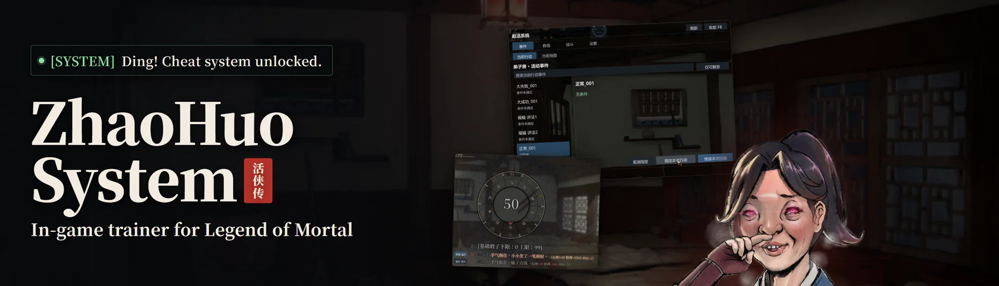

# ZhaoHuo System: in-game trainer for Legend of Mortal

[简体中文](README.md) | [繁體中文](README.zh-Hant.md) | English | [한국어](README.ko.md)

An in-game trainer and cheat panel for **Legend of Mortal** (活侠传), shipped as a BepInEx plugin. Press F8 in game to:
- see which events your next action can trigger, and pick the one you want;
- edit stats and relationships;
- preview what a dialogue choice will do;
- choose dice results;
- turn on god mode and one-hit kills in combat.

The in-game panel follows the game's language and is available in Simplified Chinese, Traditional Chinese and Korean.


## Features

- **Events**: before each action, the panel lists the events it can trigger and their conditions. Conditions show current values (for example, `Actions 3>=1`), and the ones you already meet are green. Each event also shows what it changes when it triggers (stats, affection and more), gains in green and losses in red.
  - When an action pauses, pick an event in the list and press 继续本次行动 (continue); that event triggers. Pick nothing and it stays random as usual.
  - If you are just short of a condition, press 设为 N (set to N) next to it to change the value so the condition holds.
  - When an action stops for you to choose, press 重复上次选择 (repeat last choice) to pick the same event as last time for that action.
- **Map**: locations show how many events they hold, and the badge turns green when one of them can trigger now. Hover a badge to see the list. To hide just the counts, turn off 显示地图事件数字 (show map event counts) on the 设置 (Settings) tab; other hints stay. The panel's 当前地图 (current map) list also has a 不限地点 (no fixed place) group with missions not tied to any location, and their conditions.

  

- **One-time event reminders**: map locations, and dialogue options such as picking a route while travelling, are marked when an event that can happen only once is available behind them right now. The location's badge turns green and the option gets a green ●.

- **Skip the rest of a period**: on the free-action map, and in the free phase's story menus for choosing where to go, a 跳过本旬 (skip this period) button sits to the right of the date. Click it once and it asks 确定吗？ (are you sure?); click again to give up the actions left in this ten-day period and move on to the next. It is hidden while a main-story event is waiting for you at a location.

- **Unlimited actions for a period**: next to 跳过本旬 right of the date, 本旬行动点无限 (unlimited action points this period) stops action points from being spent until the next ten-day period. Turn off 显示本旬按钮 (show period buttons) on the 设置 (Settings) tab to hide both buttons beside the date.

- **Values**: edit attributes, character affection, sect relations and story flags directly.

  

- **Dialogue choices**: each option gets a short note in brackets saying what picking it does: stat changes, conditional branches, story flags, random events and dice rolls. Locked options show the real unlock condition with current values, and what the option does once unlocked. Options that lead straight into a story when a condition holds are marked 若 … ：触发剧情 (if …: story).
  - Colours mean the same thing everywhere in the mod: green is a condition that holds, a value that goes up or an item gained; red is a condition that fails, a value that goes down or an item lost.
  - Hover the option to see the full conditions and the flags involved.

  

- **Story branches**: when the story branches on a flag or condition, a small box appears in the bottom-left corner of the game window. It lists each branch's condition with current values and marks the branch taken, and it pops and flashes its title whenever it appears or updates. Drag it anywhere and it stays there, or close it; 重置位置 (reset position) on the 设置 (Settings) tab puts it back in the corner. If you'd rather not see it, turn off 显示剧情分支小框 (Show story branch box) on the 设置 (Settings) tab; everything else stays on screen.

  

- **Dice**: each outcome gets a 指定 N% button, where N is its natural chance. Click one to roll that outcome. Outcomes your bonuses make impossible (shown as 0%) can be picked too: the dice face is worked back from the total, so the shown sum still adds up. If you click nothing, the roll stays random as usual. By default, clicking 指定 gives the result at once, without the wheel or the game's continue prompt; the game still settles it. Turn off 指定后直接出结果 (result right after 指定) on the 设置 (Settings) tab for the old flow.

  

- **Pinball**: a 总分改为 (set total to) 100 60 30 0 row sits below the total score. The story after the pinball table only checks which band the total falls in (100+, 60+, 30+ or lower), so click a value to set the total to it, then leave with the game's own button.

- **Shop**: item descriptions get one extra line with the item's actual effect.

  

- **Combat**: god mode, one-hit kill, no stamina cost and no skill cooldown. They work in both real-time battles and turn-based duels, apply only during a fight, and are not written to your save. 双方最低 1 血 (both sides keep 1 HP, duels only) keeps either side's HP from dropping below 1, for duels that must run a number of rounds. During fights, 直接胜利 (win now) and 直接失败 (lose now) buttons at the top of the screen (click twice to confirm) end the fight through the game's own result, so you can try a story's other branch quickly. Battles lock the mouse while they run, so there the buttons appear in the pause menu (Esc). In duels, a 2× (original) / 3× / 4× row sits above the game's own speed-up button at the bottom right; when speed-up is on, the duel runs at the chosen speed.

  

- **Collection**: the 收集 (Collection) tab lists the records kept in the 讲经堂 hall: achievements (风云史), deaths (生死簿) and endings (汗青书). Unlock them one at a time, or a whole list at once with 全部解锁 (unlock all). Unlocking an achievement also unlocks the matching Steam achievement, the same way the game does, and cannot be undone.

- **Save sorting**: manual saves on the load and save pages can be listed by slot number, newest first or oldest first. The button sits to the right of the 手动存档 (manual saves) heading on the load page and the 储存游戏 (save game) title on the save page; empty slots go last. The load and save pages each remember the order you last used.

- **Save stars and notes**: manual saves on the load and save pages can be starred and given a short note to tell them apart; stars and notes live in the mod's own file, never in your saves. Uninstalling the mod deletes them too.

- **50 manual save slots**: manual saves go from 20 to 50 slots (configurable from 20 to 99). After uninstalling, saves in slot 21 and above no longer appear in the game's list, but the files stay and show up again when you reinstall.

- **UI scale**: the mod grows automatically on 4K and other high resolutions; adjust it further with 界面缩放 (UI scale) on the 设置 (Settings) tab.

- **Lift the cap once**: the training, forging and alchemy panels get a 本次取消上限 (lift the cap this time) button next to the per-visit count. It removes the count cap for this visit only (shown as ∞); close and reopen the panel to get the normal cap back. Points and silver are still spent.

- **Screenshots**: hide everything the mod draws with one switch or a hotkey of your choice.

## Install

Built and tested on the Steam release, build 25987745.

1. Download the latest `ZhaoHuoSystem-v*.zip` from [Releases](https://github.com/Toufff/zhaohuo-system/releases) and extract it to any folder.
2. Close the game and double-click `install.bat`.
   - It finds Legend of Mortal in your Steam library by itself. If it can't, a window opens so you can choose the game folder (the one with `Mortal.exe`).
   - If the game doesn't have BepInEx yet, it also installs the official BepInEx 6.0.0-be.788 (Unity.Mono, Windows x64) that comes in the zip.
3. Start the game, load a save and press F8.

Edited values and chosen events end up in your save, so back up your saves before the first use.

- **Update**: download the new version and double-click `install.bat` again.
- **Uninstall**: double-click `uninstall.bat`. It removes the plugin and its settings, then asks whether to remove BepInEx too. Other BepInEx mods need it, so pressing Enter keeps it. Your saves are not affected.
- If Windows shows a security prompt, confirm that you want to run it.

### Manual install

1. In your Steam library, right-click Legend of Mortal → Manage → Browse local files. This opens the game folder (the one with `Mortal.exe`).
2. Download [BepInEx-Unity.Mono-win-x64-6.0.0-be.788](https://builds.bepinex.dev/projects/bepinex_be/788/BepInEx-Unity.Mono-win-x64-6.0.0-be.788%2B5b766a3.zip) and extract everything into the game folder.
3. Extract `ZhaoHuoSystem-v*.zip` into the game folder as well. The plugin ends up in `BepInEx/plugins/ZhaoHuoSystem/`.
4. Start the game, load a save and press F8.

- **Steam Deck / Linux**: install by hand, and set the game's launch options to `WINEDLLOVERRIDES="winhttp=n,b" %command%`.
- **Manual uninstall**: delete `BepInEx/plugins/ZhaoHuoSystem`. To remove BepInEx as well, also delete `BepInEx`, `winhttp.dll`, `doorstop_config.ini`, `.doorstop_version` and `changelog.txt` from the game folder.

## Usage

- **Open the panel**: press F8, or click the small 赵活系统 button on the left edge of the screen. You can change the hotkey on the 设置 (Settings) tab, and you can drag the button.
- **Settings file**: settings are saved to `BepInEx/config/local.zhaohuo.system.cfg`.

## After a game update

The plugin keeps working after Steam updates the game; small patches usually don't affect it. If something breaks after an update, run `uninstall.bat` to remove it and report the problem in [Issues](https://github.com/Toufff/zhaohuo-system/issues). A fixed release will follow.

## Reporting problems

Open an [issue](https://github.com/Toufff/zhaohuo-system/issues) with your game language, what you were doing and roughly when it happened. Then press 导出诊断 (export diagnostics) on the panel's 设置 (settings) tab, zip the folder it creates and attach it; its path is copied to your clipboard.

## Building from source

You need:
- Windows;
- the [.NET 9 SDK](https://dotnet.microsoft.com/download);
- a copy of the game with BepInEx installed.

The plugin compiles against the game's own assemblies in place, and nothing from the game is copied into the repository or the build.

```powershell
# Use -p:GameDir when the game is not in the default location
dotnet build src/ZhaoHuoSystem/ZhaoHuoSystem.csproj -c Release -p:GameDir="D:\SteamLibrary\steamapps\common\LegendOfMortal"

# Tests that need no game files (the same two run in CI)
dotnet run --project tests/ui-state -c Release
dotnet run --project tests/localization -c Release -- .

# Tests that use your local game installation
dotnet run --project tests/native -c Release -p:GameDir="D:\...\LegendOfMortal" -- "D:\...\LegendOfMortal"
```

The build output is `src/ZhaoHuoSystem/bin/Release/netstandard2.0/ZhaoHuoSystem.dll`. Copy it to `BepInEx/plugins/ZhaoHuoSystem/` to use it.

## License

[MIT](LICENSE) © Toufff. You can use, modify, redistribute and sell it, as long as you keep the copyright notice.

This is a fan-made mod. It is not affiliated with the developer or publisher of Legend of Mortal, and it contains no game files.
