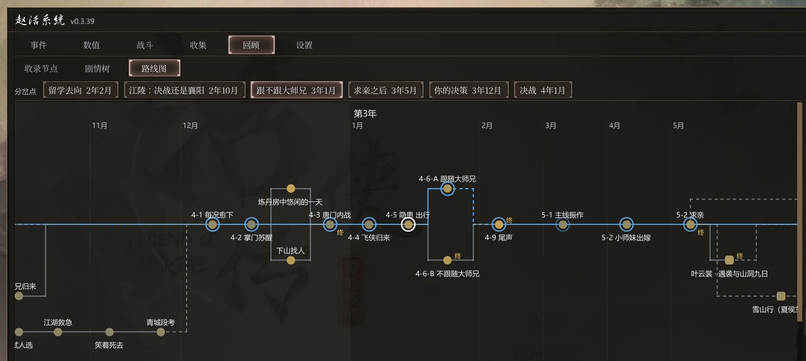

# 趙活システム：『活侠伝』ゲーム内トレーナー

[简体中文](README.md) | [繁體中文](README.zh-Hant.md) | [English](README.en.md) | [한국어](README.ko.md) | 日本語

『活侠伝』（Legend of Mortal）のゲーム内トレーナーです。BepInEx プラグインとして動作します。ゲーム中に F8 でパネルを開くと、次のことができます。
- 今回の行動で発生しうるイベントを確認し、どれを発生させるか指定する；
- 能力値や好感度を直接書き換える；
- 会話の選択肢を選ぶと何が起きるかを事前に見る；
- サイコロの結果を指定する；
- 戦闘で無敵や一撃必殺をオンにする。

開発を進めるうちに、このモッドはゲーム内トレーナーから、ゲーム全体の遊びやすさを高める総合的なモッドへと変わってきました。ただし各機能はできるだけ個別にオン／オフできるようにし、他のモッドの動作を妨げないようにしています。

パネルは日本語、英語、簡体中国語、繁体中国語、韓国語に対応しています。既定ではゲームの言語に合わせ、パネルのタイトルバーにある「更新」の左の「Language ▾」から変更できます。日本語化MOD「LOM-JPMOD」を入れてゲームの言語を簡体中国語にしている場合、「ゲームに合わせる」は日本語になり、パネルに出る人名・能力値・選択肢などのゲーム用語も日本語化MODの訳で表示されます（日本語化MODと一緒にタイトル画面で動作を確認済み）。コミュニティ英語パッチ LoM_en（BepInEx 5 + XUnity.AutoTranslator）を入れている場合は英語になります。XUnity だけで機械翻訳している場合は対象外です。日本語化MODがない場合、日本語と英語で訳されるのはパネル自体の文字だけで、パネルがゲームから読み取るイベント名・アイテム名・ストーリーはゲームの言語のままです。

> 一周目は何のモッドも使わず、原作のまま「最後的暗器」か「武林伝奇」のエンディングまで遊んでから趙活システムを使うことを強くおすすめします。まず原作の作りを味わってこそ、周回が楽しくなります。機能の制限は一切なく、初めてパネルを開いたときに一度だけお知らせします。


## 機能

- **イベント**：行動の前に、今回発生しうるイベントとその発生条件を一覧表示します。条件には現在の値が付き（例：`行動回数 3>=1`）、満たしている条件は緑で表示されます。各イベントには発生したときの変化（能力値、好感度など）も表示され、増えるものは緑、減るものは赤です。今すぐ発生できるイベントが上に並びます。
  - 行動が止まったら、一覧からイベントを選んで「今回の行動を続ける」を押すと、そのイベントが発生します。何も選ばなければ通常どおりランダムです。
  - 条件があと少し足りないときは、横の「N に設定」を押すと値が書き換わり、条件を満たせます。
  - 行動が止まって選ぶ場面では、「前回の選択を繰り返す」で、その行動で前回選んだイベントをもう一度選べます。
- **マップ**：各地点にイベント数が表示され、今すぐ発生できるイベントがある地点は緑になります。数字にマウスを乗せると一覧が見られます。数字だけ消したいときは「設定」タブの「マップのイベント数を表示」をオフにします（他の表示は残ります）。パネルの「現在のマップ」一覧には、場所を問わない任務とその条件をまとめた「場所を問わない」グループもあります。

  

- **一度きりのイベントのお知らせ**：マップの地点や、移動中の行き先選びのような会話の選択肢の先に、一度しか起きないイベントが今あるときは印が付きます。地点の数字は緑になり、選択肢には緑の ● が付きます。

- **今旬をスキップ**：自由行動のマップと、自由行動中に行き先を選ぶストーリーのメニューでは、日付の右に「今旬をスキップ」ボタンがあります。一度押すと「よろしいですか？」と聞かれ、もう一度押すとこの旬の残りの行動を放棄して次の旬に進みます。本編のイベントが地点で待っているときは表示されません。スキップは行動点ごとに確認し、途中で期限の来たストーリーがあればそこで止まります。ストーリーの中で自由行動になる場面（雲裳ルートの古寺の夜など）では、唐門のマップではなくそのメニューに戻ります。選ぶと本編が進む場面ではボタンは表示されません。

- **今旬の行動点無制限**：日付の右、「今旬をスキップ」の横にある「今旬の行動点無制限」を押すと、次の旬まで行動点が減らなくなります。「設定」タブの「今旬ボタンを表示」をオフにすると、日付横の2つのボタンを両方隠せます。

- **数値**：能力値、人物の好感度、門派との関係、ストーリーフラグを直接編集できます。「数値」タブの各値にはロックボタンがあり、「今回ロック」（ゲームを再起動するまで）か「常にロック」（セーブの切り替えや再起動後も維持）を選べます。ロックした値はストーリー、アイテム、戦闘では変わりませんが、パネルからは編集できます。武器と毒薬の開発レベルも編集できます。

  

- **六維の上限**：「設定」タブの「六維の上限」で、体力・内力・軽功・刀剣・暗器・拳掌の上限を 100 から 200 か 999 に引き上げられます。100 に戻すと、超えた分は次にその値が変わったときかロードしたときに 100 に戻ります。

- **会話の選択肢**：各選択肢の後ろに、選んだときの結果（数値の増減、条件分岐、ストーリーフラグ、ランダムイベント、サイコロ）を括弧で短く表示します。ロックされた選択肢には現在の値つきの実際の解放条件と、解放後の結果が表示されます。条件を満たすとそのままストーリーに入る選択肢には「もし …：ストーリー発生」と表示されます。ロックされた選択肢には「ワンクリック設定」ボタンもあり、満たしていない解放条件をちょうど満たすところまで書き換えて、その場で解放します。解放条件が複数の値の合計で比べられている場合（例：六道の合計 > 1）は、足りない分をそのうち1つに足します。
  - 色の意味はモッド全体で共通です。緑は満たしている条件・増える値・得るアイテム、赤は満たしていない条件・減る値・失うアイテムです。
  - 選択肢にマウスを乗せると、条件の全文と関係するフラグが見られます。

  

- **隠れた選択肢**：話題や訪問のメニューのタイトル横に「条件未達成の選択肢が N 個」という小さなボタンが出て、ゲームが隠している選択肢と必要な条件を一覧できます（緑／赤。まったく出ない選択肢は灰色）。モッドで数値やフラグを変えたあとにこのボタンを押すと、条件を満たした選択肢がメニューに現れます。設定でオフにできます。

- **ストーリー分岐**：ストーリーがフラグや条件で分岐するとき、ゲーム画面の左下に小さなボックスが出ます。各分岐の条件を現在の値つきで並べ、今回進んだ分岐に印を付けます。出たときや更新されたときは跳ねてタイトルが光ります。ドラッグして好きな場所に置け、閉じることもでき、「設定」タブの「位置をリセット」で隅に戻せます。表示したくない場合は「設定」タブの「ストーリー分岐ボックスを表示」をオフにします（他の表示はそのまま）。条件で分岐したときは、ゲームの回想にもその時点で進んだ分岐が記録されます（既定はグループごとに1行、マウスを乗せると条件の全文と現在の値。「設定」タブの「回想のストーリー分岐」で全表示か非表示に切り替え）。あわせて【この区間の始まりへ】（セーブ枠を選んでその区間の始まりからやり直す）と【これを決めた選択肢】（そのフラグを決めたスクリプトの選択肢を一覧し、記録済みの区間ならジャンプして選び直せる）が付きます。まだ通っていないルートは、【これを決めた選択肢】の「この選択肢でフラグ変更」で、その選択肢のフラグの値を分岐のある区間の始まりに書き込んでやり直せるので、ゲームが分岐をもう一度判定します（変わるのはそのフラグだけです）。

  

- **サイコロ**：各結果に「N% を指定」ボタンが付きます。N はその結果が本来出る確率です。押した結果が出ます。補正のせいで普通は出ない結果（0% と表示）も選べ、出目は合計から逆算するので、表示される合計はちゃんと合います。何も押さなければ通常どおりランダムです。既定では、指定するとルーレットやゲームの「続ける」を挟まずにすぐ結果が出ます（判定はゲーム自身が行います）。以前の流れに戻したいときは「設定」タブの「指定後すぐに結果を出す」をオフにします。

  

- **ピンボール**：合計点の下に「合計点を変更：100 60 30 0」の列が出ます。ピンボールのあとのストーリーは合計点がどの帯（100 以上、60 以上、30 以上、それ未満）に入るかしか見ないので、値を押して合計点をその値にし、ゲーム自身のボタンで終えてください。

- **ショップ**：アイテムの説明に、実際の効果を示す1行が追加されます。

  

- **戦闘**：無敵、一撃必殺、気力消費なし、技能クールダウンなし。リアルタイムの戦役とターン制の決闘の両方で使え、戦闘中だけ有効で、セーブには書き込まれません。「双方最低 1 体力」（決闘のみ）にすると双方の体力が 1 未満にならないので、決まったターン数を戦う必要のある決闘に向いています。戦闘中は画面上部に「即勝利」「即敗北」ボタンが出て（2回押して確定）、ゲーム自身の勝敗処理で戦闘を終えられるので、ストーリーの別の分岐をすぐ試せます。引き分けのエンディングがある決闘（決まったターンで勝敗なく終わるもの）では、2つのボタンの間に「即引き分け」も出て、ゲーム自身の引き分けイベントで決闘を終えます。戦役中はゲームがマウスを固定するので、ボタンは一時停止（Esc）中に表示されます。戦役の最初の「出征」画面にもこの2つのボタンがあるので、戦闘を始めてから一時停止する必要はありません。決闘では、右下のゲーム自身の加速ボタンの上で 2×（原作）／3×／4× を選べ、加速ボタンがオンのときは選んだ倍率で進みます。決闘のターン間の待ち時間も短くなり、双方に付いている状態が多いほど効果が大きくなります。効果と結果は変わりません。

  

- **収集**：「収集」タブには講経堂に残る記録、つまり実績（風雲史）、死に方（生死簿）、エンディング（汗青書）が並びます。1つずつ、または「すべて解除」で一覧ごと解放できます。実績を解放すると、ゲームと同じように対応する Steam 実績も解除され、元に戻せません。

- **ストーリー中いつでもセーブ**：選択肢やサイコロの直前を含め、ストーリーのどこでもゲーム自身のセーブが使えます。セーブには今のストーリー区間の始まりの状態が入り、ロードするとその区間の始まりからやり直します（何かが二重に数えられることはありません）。区間が始まったときに流れていた音楽や環境音も戻ります。

- **振り返り**：パネルの「振り返り」タブは、選択肢・サイコロ・戦闘のあるストーリー区間の始まりを自動で記録し（区間ごとに最新の1つ。☆を付けたものは上書きされません）、見ていない分岐に「未読」「一部既読」の印を付けます（全周回で共通）。区間を選んで「ジャンプ」を押し、手動セーブ枠（空き枠か、確認のうえで既存のセーブ）を選ぶと、ゲームがその区間の始まりから直接始まるので、別の分岐を選べます。パネルはタイトル画面でも「振り返り」タブで開きます（記録した区間、ストーリーツリー、ルートマップを、最新のセーブを基準に表示）。

- **ストーリーツリー**：「振り返り」タブを「ストーリーツリー」に切り替えると、本編の区間を本編任務の日付順に並べ、各選択肢・サイコロの結果・条件・戦闘の行き先を表示します。1段ずつ開けます。

- **ストーリールートマップ**：「振り返り」タブを「ルートマップ」に切り替えると、本編をゲーム内の暦に沿ったレーン上の駅として表示し、本編の一部と入れ替わるサイドルート（襄陽、葉雲裳の洞窟での9日間、雪山）や、巻き戻る輪として描いた序章も並べます。色で既読の度合いを示し、青い輪はこの周回で通った駅、金の輪は次の駅です。駅を開くと、その中の区間、各分岐に入る条件、そこから始まるサブストーリーが見られます（サブストーリーは入り方ごとにまとめています）。人物・場所・イベント・台詞で検索でき、暦に載らない自由行動の雑談・場所・会議も見られます。マップはドラッグで移動、Shift + ホイールで暦に沿って移動、Ctrl + ホイールか上の − と + で拡大縮小します。マップの上のボタンで本編が分かれる駅へ飛べ、マップと右の欄の境目はドラッグして幅を変えられます。駅やストーリーを選ぶと、記録された始まりがあるもの（マップ上で ▶）は「ジャンプ」で入れます。それ以外は「直接ジャンプ」で進行をそこへ移せますが、間のストーリーのフラグは付かないので不具合が起きることがあり、先に警告が出ます。「説明」でルールを確認できます。初めて開くときは約6秒かかります。マップの上の「縁結びルート」で攻略できる人物を1人選ぶと、マップで彼女のストーリーが強調され、右の欄に好感度、縁結びの進み具合、各段階で今必要なものが並びます。取り逃した段階は達成済みに設定できます。

  

- **セーブの並べ替え**：ロード画面とセーブ画面の手動セーブを、番号順・新しい順・古い順で並べられます。ボタンはロード画面の手動セーブ見出しの右と、セーブ画面のタイトルの右にあり、空き枠は最後に並びます。ロード画面とセーブ画面はそれぞれ最後に使った並び順を覚えます。並び順には「お気に入り優先」（お気に入りを先頭に）と、お気に入り以外を古い順に並べてお気に入りをその後ろに置く並び順もあります。

- **セーブのお気に入りとメモ**：ロード画面とセーブ画面の手動セーブにお気に入りの印と短いメモを付けて区別できます。お気に入りとメモはモッド自身のファイルに保存され、セーブには書き込まれません。お気に入りとメモはそのセーブに付くもので、その枠に新しいセーブを書くと、枠の古いお気に入りとメモは消えます。お気に入りのセーブを上書きするときはもう一度確認されます。モッドをアンインストールすると、これらも削除されます。

- **手動セーブ枠 50**：手動セーブ枠が 20 から 50 に増えます。「設定」タブの「手動セーブ枠の数」で 20〜99 の間で変えられ、次にロード画面かセーブ画面を開いたときに反映されます。減らしたりアンインストールしたりすると、超えた分のセーブはゲームの一覧に出なくなりますが、ファイルは残っていて、枠を戻すか再インストールすると再び表示されます。

- **セーブ機能**：「設定」タブの「セーブ機能」は既定でオンです。オフにするとゲーム本来のセーブに戻ります（ストーリー中のどこでもセーブなし、ロード・セーブ画面は 20 枠、並べ替えボタン・お気に入り・メモなし）。21 番以降のセーブ、お気に入り、メモは残っていて、オンに戻すと元どおりになります。

- **台詞の文字サイズ**：「設定」タブの「台詞の文字サイズ」で、原作、115%、130%、150% を選べ、ストーリーの会話ウィンドウの文字を大きくします。画面中央の大きなナレーションは変わりません。文字を並べるときだけ拡大し、ゲームの設定は変えません。文字を大きくする他のモッドと同時に使うと効果が重なるので、どちらか一方だけにしてください。

- **インターフェースの拡大率**：4K などの高解像度では自動で大きくなります。「設定」タブの「インターフェースの拡大率」でさらに調整できます。

- **インターフェースのスタイル**：「設定」タブの「インターフェースのスタイル」で「ゲーム素材」（既定）と「シンプル」を選べます。「ゲーム素材」はパネルとモッドのボタンをゲーム自身の枠・ボタン・フォントで描きます（ゲームが読み込み済みのものを使い、モッドはゲームのファイルを一切含みません）。「シンプル」は以前の平面的な見た目です。分岐ボックス、戦闘の勝敗ボタン、決闘の速度ボタン、選択肢のマウスオーバー表示、マップのイベント数、セーブのメモ入力も同じスタイルに従います。

- **設定の検索**：「設定」タブの上部の検索欄で、名前と説明から設定を絞り込めます。

- **ネタバレ表示**：「設定」タブの最上部の「ネタバレ表示」で、ストーリー分岐ボックス、マップのイベント数、隠れた選択肢、回想の分岐表示をまとめてオン／オフできます。一部だけオンのときは「一部オン」と表示されます。

- **テンポの改善**：自由行動のマップに戻るとき、セーブ・ロード画面を開くとき、ストーリーをスキップするときがすべて速くなり（セーブを何度も丸ごと読み直さず、スキップ中にコマンドの間で待たなくなりました）、台詞ごとに回想を作り直すこともなくなりました。オートは台詞が表示しきってから、長さに応じた時間でページを送ります。「設定」タブの「数値変化での停止」（原作の 0.5 秒／0.2 秒／なし）と「自由行動の場面転換」（原作／3倍速）でさらに速くできます。どちらも既定は原作どおりです。

- **全体加速**：「設定」タブの「全体加速」で、ストーリー、自由行動のマップ、ターン制の決闘、リアルタイムの戦役を含むゲーム全体を 1.5×／2×／3× で動かせます（戦闘ではゲーム自身の速度に掛け合わせ、一時停止はそのまま効きます）。音楽は変わらず、オートでも読む時間は十分に残ります。切り替えのショートカット（「加速のショートカット」）を設定で割り当てられます（既定は未割り当て）。

- **今回だけ上限解除**：修練・鍛造・錬丹の画面で、1回あたりの回数の横に「今回だけ上限解除」ボタンが付きます。今回の訪問に限って回数の上限を外します（∞ と表示）。画面を閉じて開き直すと通常の上限に戻ります。ポイントと銀両は通常どおり消費します。

- **スクリーンショット**：スイッチ1つか好きなショートカットで、モッドの表示をすべて隠せます。

## インストール

Steam 版 build 26073097 で開発・テストしています。

1. [Releases](https://github.com/Toufff/zhaohuo-system/releases) から最新の `ZhaoHuoSystem-v*.zip` をダウンロードし、好きなフォルダに展開します。
2. ゲームを終了し、`install.bat` をダブルクリックします。
   - Steam ライブラリから『活侠伝』を自動で探します。見つからない場合はウィンドウが開くので、ゲームフォルダ（`Mortal.exe` があるフォルダ）を選んでください。
   - ゲームにまだ BepInEx がなければ、zip に同梱された公式の BepInEx 6.0.0-be.788（Unity.Mono、Windows x64）も入れます。
3. ゲームを起動し、セーブをロードして F8 を押します。

数値の変更とイベントの指定はセーブに書き込まれるので、初めて使う前にセーブをバックアップしてください。

- **更新**：新しいバージョンをダウンロードし、もう一度 `install.bat` をダブルクリックします。
- **アンインストール**：`uninstall.bat` をダブルクリックします。プラグインと設定を削除したあと、BepInEx も削除するか聞かれます。BepInEx を使う他のモッドもあるので、Enter を押すと残します。セーブには影響しません。
- Windows のセキュリティ確認が出たら、実行することを確認してください。

### 日本語化MOD（LOM-JPMOD）と一緒に使う

日本語化MODを入れたゲームにも上の手順で入れられます。インストーラーはすでに入っている BepInEx 6 をそのまま使い、趙活システムのプラグインだけを追加します。手動で入れる場合は、`ZhaoHuoSystem-v*.zip` の中の `BepInEx/plugins/ZhaoHuoSystem` フォルダをゲームフォルダの同じ場所にコピーするだけでも使えます。ゲームの言語を簡体中国語にしておくと、パネルは自動で日本語になります。一緒に動作を確認したのは BepInEx 6.0.0-be.788 上でです。

### BepInEx 5 がすでに入っているゲーム

英語翻訳パッチ（BepInEx 5.4.23.5 + XUnity.AutoTranslator）などで、ゲームがすでに BepInEx 5 で動いている場合は、代わりに `ZhaoHuoSystem-v*-BepInEx5.zip` を使ってください。展開して `install.bat` をダブルクリックすると、趙活システムのプラグインだけを入れ、BepInEx はインストールも変更もしません。ゲームが BepInEx 5 でない場合は、どのパッケージを使うべきか表示し、何も変更しません。BepInEx がまったくない場合は、上の通常パッケージを使ってください。

スクリプトを実行したくない場合は、`ZhaoHuoSystem-v*-BepInEx5-manual.zip` をダウンロードしてゲームフォルダに展開するだけでも構いません。

### 手動インストール

1. Steam ライブラリで『活侠伝』を右クリック → 管理 → ローカルファイルを閲覧。ゲームフォルダ（`Mortal.exe` があるフォルダ）が開きます。
2. [BepInEx-Unity.Mono-win-x64-6.0.0-be.788](https://builds.bepinex.dev/projects/bepinex_be/788/BepInEx-Unity.Mono-win-x64-6.0.0-be.788%2B5b766a3.zip) をダウンロードし、中身をすべてゲームフォルダに展開します。
3. `ZhaoHuoSystem-v*.zip` もゲームフォルダに展開します。プラグインは `BepInEx/plugins/ZhaoHuoSystem/` に入ります。
4. ゲームを起動し、セーブをロードして F8 を押します。

- **Steam Deck / Linux**：手動でインストールし、ゲームの起動オプションに `WINEDLLOVERRIDES="winhttp=n,b" %command%` を入力してください。
- **手動アンインストール**：`BepInEx/plugins/ZhaoHuoSystem` フォルダを削除します。BepInEx も削除する場合は、ゲームフォルダの `BepInEx`、`winhttp.dll`、`doorstop_config.ini`、`.doorstop_version`、`changelog.txt` も削除します。

## 使い方

- **パネルを開く**：F8 を押すか、画面左端の小さな「趙活システム」ボタンを押します。ショートカットは「設定」タブで変えられ、ボタンはドラッグで動かせます。
- **キーボード操作**：パネルでは方向キーでボタンと入力欄の間を移動し（今の項目に金色の枠）、Enter か Space でボタンを押し、入力欄で Enter を押すと入力を始めます。言語のドロップダウンが開いているときは上下キーで選び、Enter で確定、Esc で閉じます。方向キーは最後にパネルをクリックしたときだけパネルに渡り、Enter と Space は方向キーを一度押したあとだけパネルに渡るので、パネルを開いたままでも Enter と Space で会話を進められます。パネルの外を一度クリックすると、キーボードはゲームに戻ります。
- **設定ファイル**：設定は `BepInEx/config/local.zhaohuo.system.cfg` に保存されます。

## ゲームのアップデート後

Steam がゲームを更新してもプラグインはそのまま動き、小さなパッチなら通常は影響ありません。更新後に何かおかしくなったら、`uninstall.bat` で削除し、[Issues](https://github.com/Toufff/zhaohuo-system/issues) で報告してください。修正版を出します。

## 不具合の報告

[Issue](https://github.com/Toufff/zhaohuo-system/issues) を作成し、ゲームの言語、何をしていたか、だいたいいつ起きたかを書いてください。それからパネルの「設定」タブで「診断を書き出す」を押し、作られたフォルダを zip にして添付してください（フォルダのパスはクリップボードにコピーされます）。

## ソースからのビルド

必要なもの：
- Windows；
- [.NET 9 SDK](https://dotnet.microsoft.com/download)；
- BepInEx を入れたゲーム本体。

プラグインはゲーム自身のアセンブリをその場で参照してコンパイルし、ゲームのものはリポジトリにもビルドにも一切コピーしません。

```powershell
# ゲームが既定の場所にない場合は -p:GameDir を指定
dotnet build src/ZhaoHuoSystem/ZhaoHuoSystem.csproj -c Release -p:GameDir="D:\SteamLibrary\steamapps\common\LegendOfMortal"

# ゲームのファイルが不要なテスト（CI でも同じ2つを実行）
dotnet run --project tests/ui-state -c Release
dotnet run --project tests/localization -c Release -- .

# ローカルのゲームを使うテスト
dotnet run --project tests/native -c Release -p:GameDir="D:\...\LegendOfMortal" -- "D:\...\LegendOfMortal"
```

ビルド結果は `src/ZhaoHuoSystem/bin/Release/netstandard2.0/ZhaoHuoSystem.dll` です。使うときは `BepInEx/plugins/ZhaoHuoSystem/` にコピーしてください。

## ライセンス

[MIT](LICENSE) © Toufff。著作権表示を残せば、使用・改変・再配布・販売ができます。

ファンメイドのモッドで、『活侠伝』の開発元・販売元とは関係がなく、ゲームのファイルは一切含みません。
