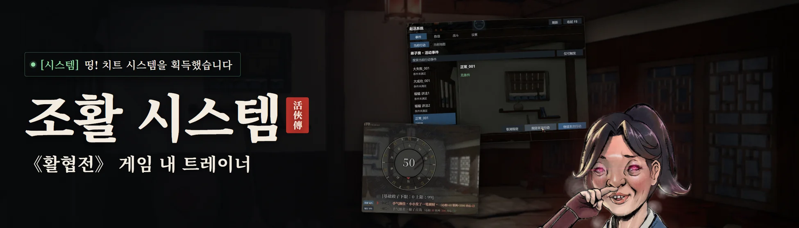

# 조활 시스템: 《활협전》 게임 내 트레이너

[简体中文](README.md) | [繁體中文](README.zh-Hant.md) | [English](README.en.md) | 한국어

《활협전》(Legend of Mortal, 活侠传)용 게임 내 트레이너(치트 패널)이며, BepInEx 플러그인으로 동작합니다. 게임에서 F8을 누르면 패널이 열리고 다음 기능을 쓸 수 있습니다.

- 이번 행동에서 발생할 수 있는 이벤트를 확인하고, 원하는 이벤트를 지정합니다.
- 능력치와 호감도를 직접 수정합니다.
- 대화 선택지의 결과를 미리 확인합니다.
- 주사위 결과를 지정합니다.
- 전투에서 무적, 일격필살을 켭니다.

게임 내 패널은 게임 언어를 따르며 한국어, 중국어 간체, 중국어 번체를 지원합니다.


## 기능

- **이벤트**: 행동하기 전에, 이번 행동에서 발생할 수 있는 이벤트와 발생 조건을 패널에 보여 줍니다. 조건에는 현재 값과 목표 값이 함께 표시되며, 이미 충족한 조건은 초록색으로 나타납니다.
  - 이벤트를 고른 뒤 「이번 행동 지정」을 누르면 이번 행동에서 그 이벤트가 발생합니다.
  - 조건이 조금 모자랄 때는 조건 옆의 「N(으)로 설정」을 누르면 값을 바로 맞출 수 있습니다.
- **지도**: 장소 옆에 이벤트 수가 표시되고, 지금 발생할 수 있는 이벤트가 있으면 초록색으로 바뀝니다. 마우스를 올리면 이벤트 목록을 볼 수 있습니다.

  

- **수치**: 능력치, 인물 호감도, 문파 관계, 스토리 플래그를 직접 수정합니다.

  

- **대화 선택지**: 선택지 뒤 괄호 안에 그 선택지를 고르면 일어나는 일을 짧게 적어 줍니다. 능력치 증감, 조건 분기, 스토리 플래그, 랜덤 이벤트, 주사위 판정 등이 표시됩니다.
  - 모드 전체에서 색의 의미는 하나입니다. 초록색은 충족된 조건, 오르는 수치, 얻는 아이템이고, 빨간색은 충족되지 않은 조건, 내려가는 수치, 잃는 아이템입니다.
  - 선택지에 마우스를 올리면 전체 조건과 관련 플래그를 볼 수 있습니다.

  

- **스토리 분기**: 스토리가 플래그나 조건에 따라 갈라질 때 대화창 왼쪽의 고정된 위치에 작은 창이 떠서 각 분기의 조건과 현재 값을 보여 주고, 이번에 선택된 분기를 표시합니다. 나타나거나 내용이 바뀔 때 살짝 튀어 오르고 제목이 깜박입니다. 창은 끌어서 옮기거나 닫을 수 있으며, 다음 분기에서 원래 위치에 다시 나타납니다.

  

- **주사위**: 각 결과 옆에 「지정 N%」 버튼이 있어서, 누른 결과가 그대로 나옵니다. N은 원래 확률입니다. 보너스 때문에 원래는 나올 수 없는 결과(0%로 표시)도 고를 수 있으며, 주사위 눈을 총합에서 거꾸로 계산하므로 표시되는 계산이 그대로 맞습니다. 누르지 않으면 원래대로 무작위로 굴립니다.

  

- **상점**: 아이템 설명 아래에 실제 효과가 한 줄 추가됩니다.

  

- **전투**: 무적, 일격필살, 기력 유지, 스킬 쿨타임 없음 기능을 제공합니다. 실시간 전역과 턴제 결투 모두에서 쓸 수 있으며, 전투 중에만 적용되고 세이브에는 기록되지 않습니다.

  

- **스크린샷**: 모드가 표시하는 화면을 한 번에 숨길 수 있고, 단축키도 지정할 수 있습니다.

## 설치

Steam 버전 build 25957922에서 개발하고 테스트했습니다.

1. [Releases](https://github.com/Toufff/zhaohuo-system/releases)에서 최신 `ZhaoHuoSystem-v*.zip`을 내려받아 아무 폴더에나 압축을 풉니다.
2. 게임을 종료하고 `install.bat`을 더블클릭합니다.
   - Steam 라이브러리에서 《활협전》을 자동으로 찾습니다. 찾지 못하면 창이 열리니 게임 폴더(`Mortal.exe`가 있는 폴더)를 선택하세요.
   - 게임에 아직 BepInEx가 없으면, 압축 파일에 함께 들어 있는 공식 BepInEx 6.0.0-be.788(Unity.Mono, Windows x64)도 같이 설치합니다.
3. 게임을 실행해 세이브를 불러온 뒤 F8을 누릅니다.

수정한 수치와 지정한 이벤트는 세이브에 반영됩니다. 처음 사용하기 전에 세이브를 백업해 두세요.

- **업데이트**: 새 버전을 내려받아 `install.bat`을 다시 더블클릭합니다.
- **삭제**: `uninstall.bat`을 더블클릭합니다. 플러그인과 설정을 지운 뒤 BepInEx도 함께 지울지 묻습니다. 다른 BepInEx 모드도 BepInEx가 필요하므로, Enter만 누르면 유지됩니다. 세이브 파일에는 영향이 없습니다.
- Windows 보안 경고가 나타나면 실행을 선택하세요.

### 수동 설치

1. Steam 라이브러리에서 《활협전》을 우클릭 → 관리 → 로컬 파일 보기를 눌러, `Mortal.exe`가 있는 게임 폴더를 엽니다.
2. [BepInEx-Unity.Mono-win-x64-6.0.0-be.788](https://builds.bepinex.dev/projects/bepinex_be/788/BepInEx-Unity.Mono-win-x64-6.0.0-be.788%2B5b766a3.zip)을 내려받아, 압축 파일 안의 내용을 모두 게임 폴더에 풉니다.
3. `ZhaoHuoSystem-v*.zip`도 게임 폴더에 풉니다. 플러그인은 `BepInEx/plugins/ZhaoHuoSystem/`에 들어갑니다.
4. 게임을 실행해 세이브를 불러온 뒤 F8을 누릅니다.

- **Steam Deck / Linux**: 수동으로 설치하고, 게임 속성의 시작 옵션에 `WINEDLLOVERRIDES="winhttp=n,b" %command%`를 입력합니다.
- **수동 삭제**: `BepInEx/plugins/ZhaoHuoSystem` 폴더를 지웁니다. BepInEx까지 지우려면 게임 폴더의 `BepInEx`, `winhttp.dll`, `doorstop_config.ini`, `.doorstop_version`, `changelog.txt`도 함께 지웁니다.

## 사용법

- **패널 열기**: F8을 누르거나, 화면 왼쪽의 작은 「조활 시스템」 버튼을 누릅니다. 단축키는 「설정」 탭에서 바꿀 수 있고, 버튼은 끌어서 옮길 수 있습니다.
- **설정 파일**: 설정은 `BepInEx/config/local.zhaohuo.system.cfg`에 저장됩니다.

## 게임이 업데이트되면

게임이 업데이트되어도 플러그인은 그대로 동작합니다. 작은 업데이트는 대부분 영향이 없습니다. 업데이트 후 문제가 생기면 `uninstall.bat`으로 삭제한 뒤 [Issues](https://github.com/Toufff/zhaohuo-system/issues)에 알려 주세요. 수정된 버전을 올리겠습니다.

## 문제 신고

[Issues](https://github.com/Toufff/zhaohuo-system/issues)에 게임 언어, 문제가 생긴 상황과 대략적인 시간을 적어 주세요. 그런 다음 패널의 「설정」 탭에서 「진단 내보내기」를 눌러 만들어진 폴더를 압축해 첨부해 주세요. 폴더 경로는 클립보드에 자동으로 복사됩니다.

## 소스에서 빌드하기

준비할 것:

- Windows
- [.NET 9 SDK](https://dotnet.microsoft.com/download)
- BepInEx가 설치된 게임

플러그인은 게임 폴더에 있는 어셈블리를 그대로 참조해서 컴파일합니다. 게임 파일은 저장소나 빌드 결과물에 복사되지 않습니다.

```powershell
# 게임이 기본 경로에 없으면 -p:GameDir로 게임 폴더를 지정합니다
dotnet build src/ZhaoHuoSystem/ZhaoHuoSystem.csproj -c Release -p:GameDir="D:\SteamLibrary\steamapps\common\LegendOfMortal"

# 게임 파일이 필요 없는 테스트 (CI에서도 이 두 개를 실행합니다)
dotnet run --project tests/ui-state -c Release
dotnet run --project tests/localization -c Release -- .

# 로컬 게임 설치가 필요한 테스트
dotnet run --project tests/native -c Release -p:GameDir="D:\...\LegendOfMortal" -- "D:\...\LegendOfMortal"
```

빌드 결과물은 `src/ZhaoHuoSystem/bin/Release/netstandard2.0/ZhaoHuoSystem.dll`이며, `BepInEx/plugins/ZhaoHuoSystem/`에 넣으면 됩니다.

## 라이선스

[MIT](LICENSE) © Toufff. 상업적 이용을 포함해 자유롭게 사용, 수정, 재배포할 수 있습니다. 저작권 고지만 남겨 주세요.

플레이어가 만든 비공식 모드이며, 《활협전》의 개발사 및 배급사와는 관계가 없습니다. 게임 파일은 포함되어 있지 않습니다.
