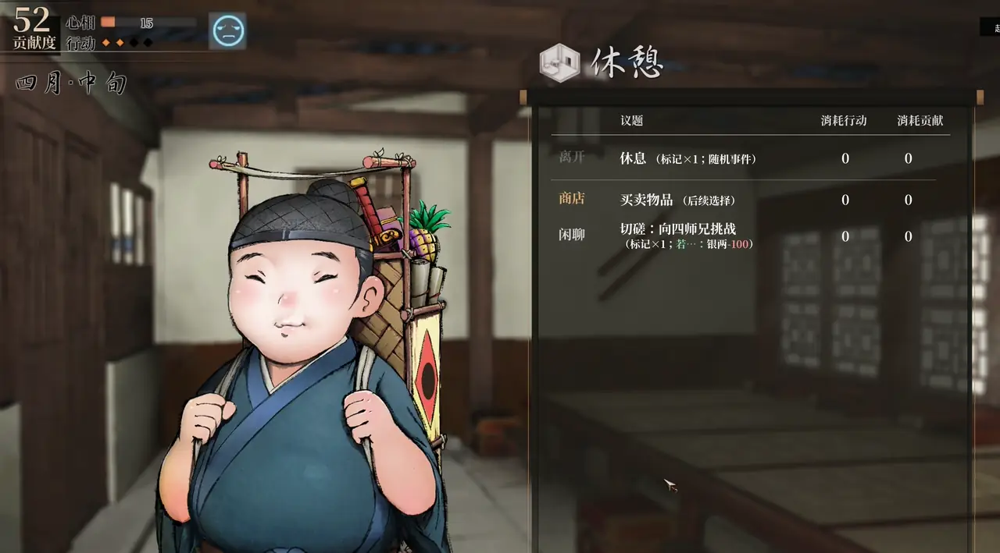
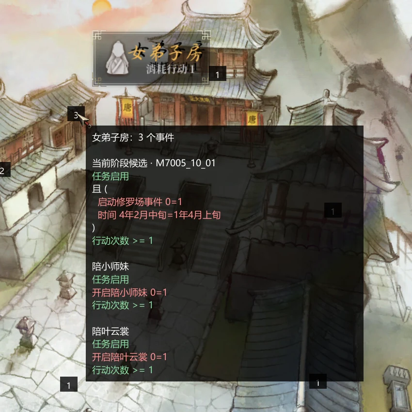
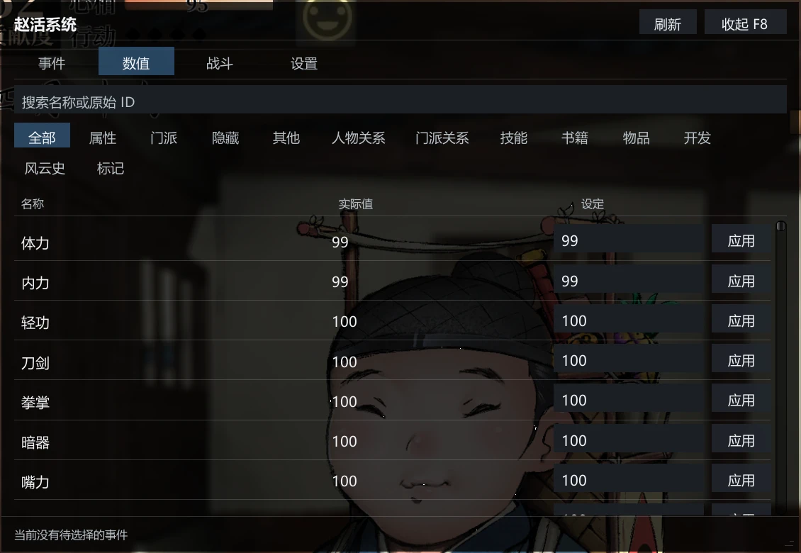
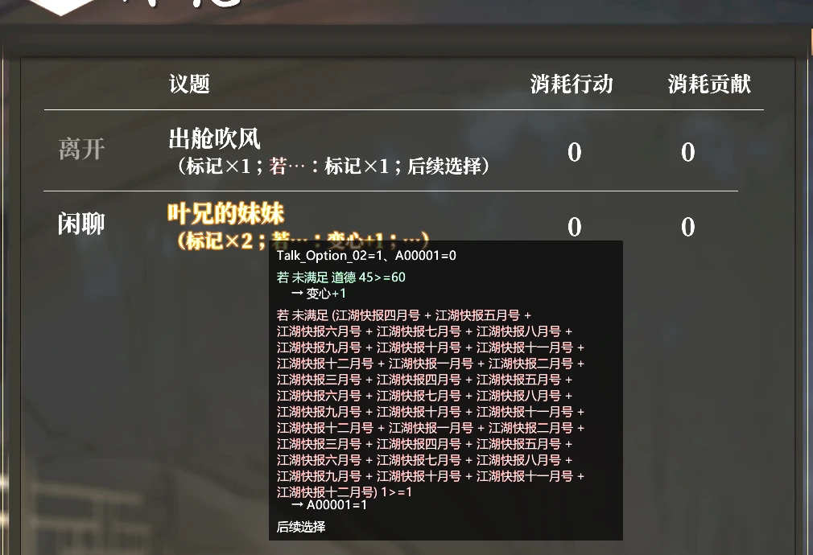
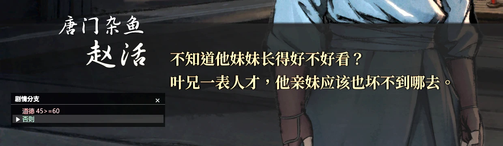
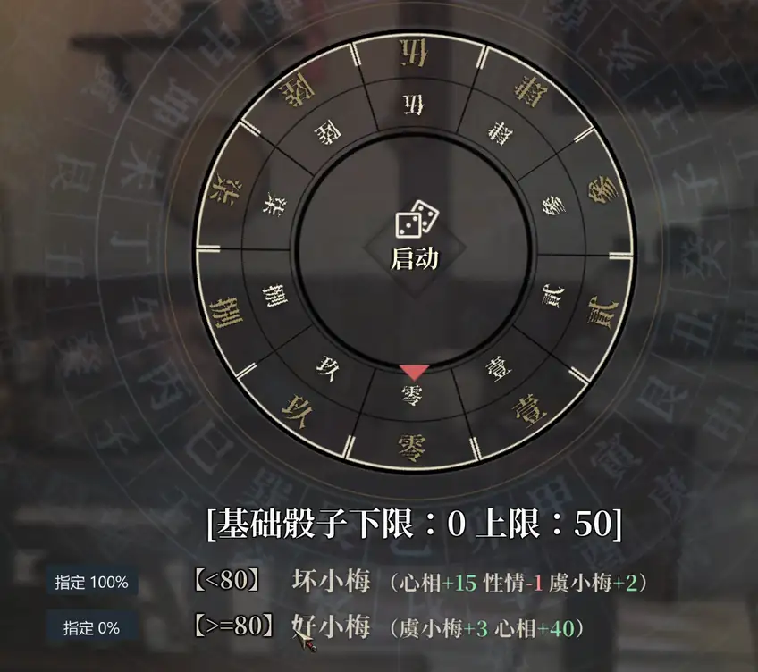
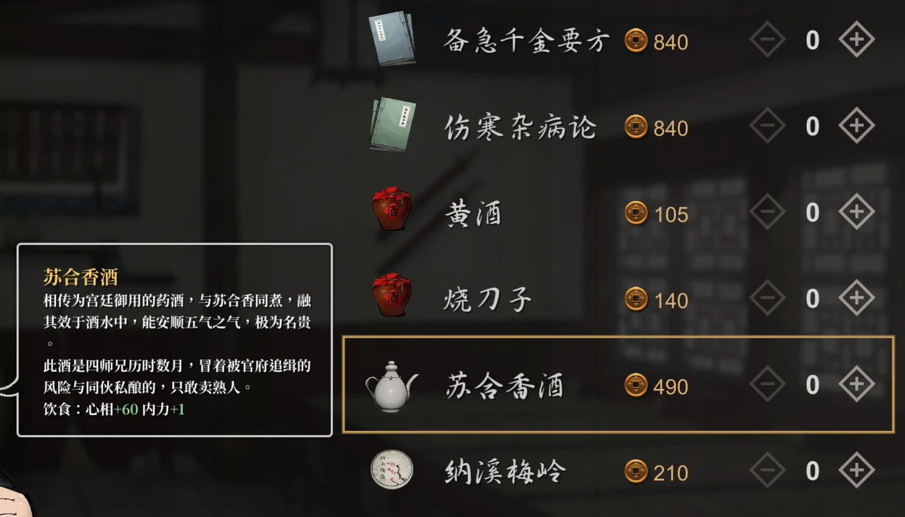
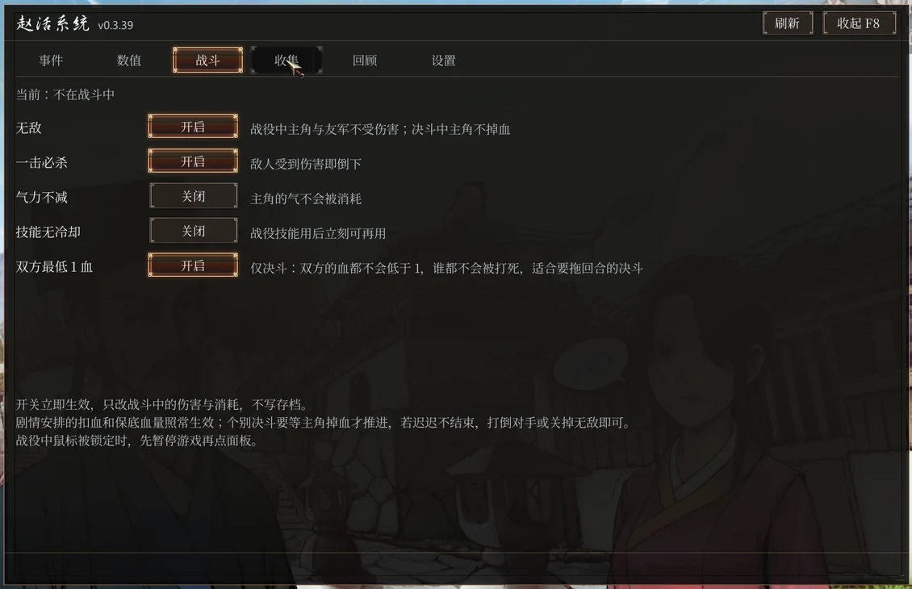
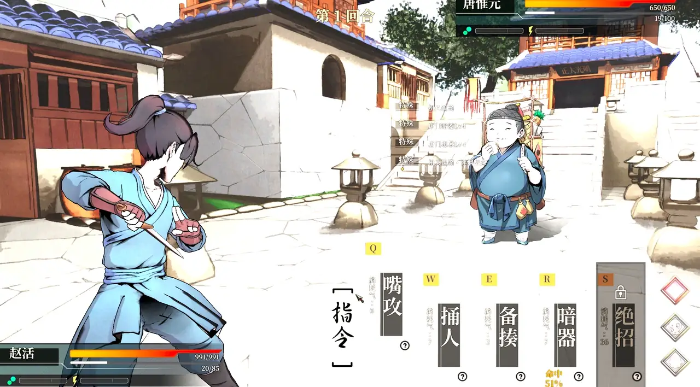

# 赵活系统：《活侠传》游戏内修改器

简体中文 | [繁體中文](README.zh-Hant.md) | [English](README.en.md) | [한국어](README.ko.md)

《活侠传》（Legend of Mortal）的游戏内修改器，以 BepInEx 插件的形式运行。进游戏后按 F8 打开面板，可以：
- 查看这次行动会触发哪些事件，并指定触发哪一个；
- 直接修改属性和好感；
- 提前看到对话选项会带来什么结果；
- 指定骰子投出的结果；
- 在战斗里开启无敌、一击必杀。



## 能做什么

- **事件**：每次行动前，面板列出这次可能触发的事件和触发条件。条件里带着当前值（例如「行动次数 3>=1」），满足的显示为绿色。
  - 选中一个事件后点「指定本次行动」，这次行动就会触发它。
  - 条件还差一点时，可以点条件旁的「设为 N」，直接把数值改到满足。
- **地图**：地点旁会标出有几个事件，有可以触发的事件时标记显示为绿色。鼠标移上去能看到事件列表。

  

- **数值**：属性、人物好感、门派关系、剧情标记都可以直接修改。

  

- **对话选项**：选项后面用括号写出选了会怎样，比如属性加减、「若…」条件分支、剧情标记、随机事件、掷骰。
  - 整个模组里颜色只有一种含义：绿色表示条件满足、数值增加或获得物品，红色表示条件不满足、数值减少或失去物品。
  - 鼠标移到选项上，可以看到完整的条件和具体标记。

  

- **剧情分支**：剧情按标记或条件分支时，对话框左侧的固定位置弹出小框，列出每个分支的条件和当前值，并标出这次走的是哪一支。出现或更新时会弹一下、标题闪烁提醒。小框可以拖动，也可以关掉，下次分支会回到原位再弹出。

  

- **骰子**：每个结果旁有「指定 N%」按钮，点哪个就投出哪个，N 是这一档原本的概率。加成太高或太低、正常投不出来的结果（显示 0%）也能选，骰面会按总点数倒推，算式照样对得上。不点的话，就是游戏原本的随机。

  

- **商店**：道具说明下面多一行实际效果。

  

- **战斗**：无敌、一击必杀、气力不减、技能无冷却，即时战役和回合制决斗都能用。这些开关只在战斗中生效，不写进存档。

  

  

- **截图**：可以一键隐藏模组的全部界面，也可以给它绑定快捷键。

## 安装

适配 Steam 版 build 25957922。

1. 从 [Releases](https://github.com/Toufff/zhaohuo-system/releases) 下载最新的 `ZhaoHuoSystem-v*.zip`，解压到任意文件夹。
2. 关闭游戏，双击 `install.bat`。
   - 它会自动找到 Steam 里的《活侠传》；找不到时会弹出窗口，让你选择游戏文件夹（有 `Mortal.exe` 的那个）。
   - 游戏还没有 BepInEx 时，会一并装上压缩包里附带的官方 BepInEx 6.0.0-be.788（Unity.Mono，Windows x64）。
3. 启动游戏，读档后按 F8 打开面板。

修改数值和指定事件都会写进存档，第一次使用前请先备份存档。

- **更新**：下载新版本，再双击一次 `install.bat`。
- **卸载**：双击 `uninstall.bat`。它会删除插件和设置，然后询问是否连 BepInEx 一起删除；其他 BepInEx 模组也依赖它，直接回车就会保留。存档不受影响。
- 如果 Windows 弹出安全提示，确认运行即可。

### 手动安装

1. 在 Steam 库里右键《活侠传》→ 管理 → 浏览本地文件，打开游戏目录（有 `Mortal.exe` 的文件夹）。
2. 下载 [BepInEx-Unity.Mono-win-x64-6.0.0-be.788](https://builds.bepinex.dev/projects/bepinex_be/788/BepInEx-Unity.Mono-win-x64-6.0.0-be.788%2B5b766a3.zip)，把压缩包里的全部内容解压到游戏目录。
3. 把 `ZhaoHuoSystem-v*.zip` 也解压到游戏目录，插件会位于 `BepInEx/plugins/ZhaoHuoSystem/`。
4. 进入游戏并读档，按 F8 打开面板。

- **Steam Deck / Linux**：只能手动安装，并在游戏的启动选项里填 `WINEDLLOVERRIDES="winhttp=n,b" %command%`。
- **手动卸载**：删除 `BepInEx/plugins/ZhaoHuoSystem` 文件夹。如果要把 BepInEx 也删掉，再删除游戏目录里的 `BepInEx`、`winhttp.dll`、`doorstop_config.ini`、`.doorstop_version` 和 `changelog.txt`。

## 使用

- **打开面板**：按 F8，或点击屏幕左侧的「赵活系统」小按钮。快捷键可以在「设置」页修改，小按钮可以拖动。
- **语言**：界面语言跟随游戏，支持简体中文、繁体中文和韩语。
- **配置文件**：设置保存在 `BepInEx/config/local.zhaohuo.system.cfg`。

## 游戏更新以后

插件只在适配过的游戏版本上工作。Steam 更新游戏后，插件会自动停用，不会改动游戏；等这里发布新版本后再更新即可。

想确认是不是这个原因，可以打开 `BepInEx/LogOutput.log`：如果里面出现 `compatible=False`，说明当前游戏版本还没有适配。

## 反馈问题

请在 [Issues](https://github.com/Toufff/zhaohuo-system/issues) 里说明游戏语言、在哪个场景出的问题、大概什么时候发生的。然后在面板「设置」页点「导出诊断」，把导出的文件夹压缩后附上（路径会自动复制到剪贴板）。

## 从源码构建

需要准备：
- Windows；
- [.NET SDK 9](https://dotnet.microsoft.com/download)；
- 一份已经装好 BepInEx 的游戏。

插件编译时直接引用游戏目录里的程序集，不会复制这些文件。

```powershell
# 游戏不在默认路径时，用 -p:GameDir 指定游戏目录
dotnet build src/ZhaoHuoSystem/ZhaoHuoSystem.csproj -c Release -p:GameDir="D:\SteamLibrary\steamapps\common\LegendOfMortal"

# 不需要游戏的测试，CI 也跑这两项
dotnet run --project tests/ui-state -c Release
dotnet run --project tests/localization -c Release -- .

# 需要本机游戏的测试
dotnet run --project tests/native -c Release -p:GameDir="D:\...\LegendOfMortal" -- "D:\...\LegendOfMortal"
```

构建结果是 `src/ZhaoHuoSystem/bin/Release/netstandard2.0/ZhaoHuoSystem.dll`，把它放进 `BepInEx/plugins/ZhaoHuoSystem/` 即可。

## 许可证

[MIT](LICENSE) © Toufff。可以自由使用、修改、再发布，也可以商用，只需保留版权声明。

这是玩家自制的模组，与《活侠传》的开发商和发行商无关，不包含任何游戏文件。
